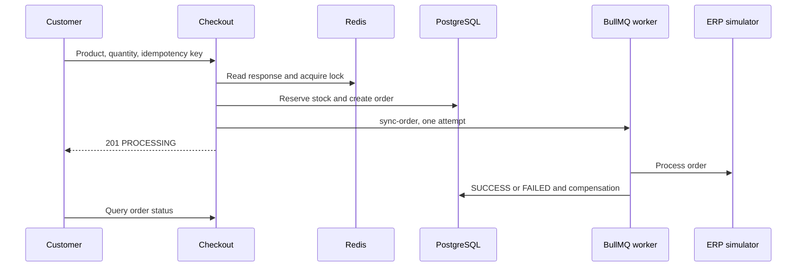

# Architecture & design

Product checkout with stock reservation, orders, idempotency and asynchronous synchronization with a simulated ERP. It includes catalog, authentication, order history/status and administration. The initial response confirms acceptance for processing; the ERP outcome is queried later.

## Implemented behavior

NestJS 10.3, Prisma 5.11/PostgreSQL, Redis, BullMQ 4, JWT/Passport and Argon2. Domain holds entities/contracts; application commands/queries/ports; infrastructure Prisma/Redis/queue/ERP adapters; presentation controllers. Frontend declares Next.js ^15.0.0-canary.120, React ^18.3.1, Redux Persist and TanStack Query 5. Check the lockfile for resolved versions; the manifest uses a prerelease range.

## Related files

- [backend/src/main.ts](https://github.com/Vidigal-code/casecell-checkout-service/blob/0710aade2a2137cc98f52f138f8c883e7fdd4a4b/backend/src/main.ts)
- [backend/src/presentation/http/checkout/checkout.controller.ts](https://github.com/Vidigal-code/casecell-checkout-service/blob/0710aade2a2137cc98f52f138f8c883e7fdd4a4b/backend/src/presentation/http/checkout/checkout.controller.ts)
- [backend/src/application/checkout/create-checkout.command.ts](https://github.com/Vidigal-code/casecell-checkout-service/blob/0710aade2a2137cc98f52f138f8c883e7fdd4a4b/backend/src/application/checkout/create-checkout.command.ts)
- [backend/src/application/checkout/enqueue-erp-sync.command.ts](https://github.com/Vidigal-code/casecell-checkout-service/blob/0710aade2a2137cc98f52f138f8c883e7fdd4a4b/backend/src/application/checkout/enqueue-erp-sync.command.ts)
- [backend/src/infrastructure/queues/erp-sync.processor.ts](https://github.com/Vidigal-code/casecell-checkout-service/blob/0710aade2a2137cc98f52f138f8c883e7fdd4a4b/backend/src/infrastructure/queues/erp-sync.processor.ts)
- [backend/prisma/schema.prisma](https://github.com/Vidigal-code/casecell-checkout-service/blob/0710aade2a2137cc98f52f138f8c883e7fdd4a4b/backend/prisma/schema.prisma)
- [docker-compose.yml](https://github.com/Vidigal-code/casecell-checkout-service/blob/0710aade2a2137cc98f52f138f8c883e7fdd4a4b/docker-compose.yml)

## Navigation

- [Project guide](?menu=en&lang=en&id=8)
- [Source reference](?menu=en&lang=en&id=9)
