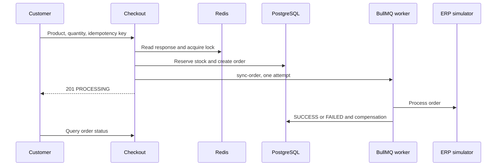

# casecell-checkout-service: Project context and workflows

GitPageDocs **0.0.25** · 1.0.0 · 2026-11-08

## Context

Product checkout with stock reservation, orders, idempotency and asynchronous synchronization with a simulated ERP. It includes catalog, authentication, order history/status and administration. The initial response confirms acceptance for processing; the ERP outcome is queried later.

## Stack and architecture

NestJS 10.3, Prisma 5.11/PostgreSQL, Redis, BullMQ 4, JWT/Passport and Argon2. Domain holds entities/contracts; application commands/queries/ports; infrastructure Prisma/Redis/queue/ERP adapters; presentation controllers. Frontend declares Next.js ^15.0.0-canary.120, React ^18.3.1, Redux Persist and TanStack Query 5. Check the lockfile for resolved versions; the manifest uses a prerelease range.



## End-to-end workflows

1. Authentication → catalog → one productId and quantity → POST /api/v1/checkout with Bearer JWT and Idempotency-Key. Only CUSTOMER can checkout; customerId comes from the token. Missing key returns 400. DTO/use case validate quantity/product; price comes from the database.

2. Redis idempotency lookup returns duplicate=true/HTTP 200 when cached. Otherwise it acquires lock:product:{id} for 5000 ms. A Prisma transaction verifies an active product, conditionally decrements stock where stock >= quantity and creates a PENDING order/items. Insufficient stock returns 409; missing/inactive products fail. It then marks PROCESSING, queues sync-order and caches the response with configurable TTL (default 600 s). Initial success is HTTP 201.

3. The worker reads the order and erp:global circuit breaker. Gateway success marks SUCCESS, updates idempotency, invalidates catalog and records metrics. Failure/open circuit marks FAILED and attempts stock release; gateway errors are rethrown. EnqueueErpSyncCommand uses attempts:1 and no backoff: this job has no automatic business retry. Failed jobs are retained for inspection.

4. The UI follows order status/history; administration changes products and queries orders according to roles. Technical failures after reservation attempt stock compensation and FAILED status. Compensation has its own logs and can fail; inspect database/queue before manually retrying an order.

## Data, security and limitations

Core model: User, Product, Order and OrderItem; prices/totals use cents. Token revocation, password hashing and role guards are implemented. This command's idempotency cache uses the supplied key without payload comparison: generate a new key per purchase intent and reuse it only for the same intent. Enqueue happens after SQL commit without a transactional outbox; failures between stages require inspection. TTL locks/unique keys do not guarantee end-to-end exactly-once execution.

## Setup, testing and operations

Copy envexample.txt to .env. Compose contains PostgreSQL, Redis, backend/frontend and test services. Prisma scripts use run-with-env; distinguish prisma:migrate (development) from prisma:deploy (existing migrations). Backend npm test runs database-preparing pretest: use a dedicated test database. Run unit/integration/e2e, lint/build per package.json. Persistent PROCESSING: worker/queue; FAILED: ERP/compensation logs; 409: stock/lock; 401/403: token/role. HTTP metrics/Pino help correlation; the current ERP is simulated.

## Complete reference

Dependencies, commands, endpoints, variables, contracts and tests are in the [source reference](?menu=en&lang=en&id=9).

## Verifiable sources

- [backend/src/main.ts](https://github.com/Vidigal-code/casecell-checkout-service/blob/0710aade2a2137cc98f52f138f8c883e7fdd4a4b/backend/src/main.ts)

- [backend/src/presentation/http/checkout/checkout.controller.ts](https://github.com/Vidigal-code/casecell-checkout-service/blob/0710aade2a2137cc98f52f138f8c883e7fdd4a4b/backend/src/presentation/http/checkout/checkout.controller.ts)

- [backend/src/application/checkout/create-checkout.command.ts](https://github.com/Vidigal-code/casecell-checkout-service/blob/0710aade2a2137cc98f52f138f8c883e7fdd4a4b/backend/src/application/checkout/create-checkout.command.ts)

- [backend/src/application/checkout/enqueue-erp-sync.command.ts](https://github.com/Vidigal-code/casecell-checkout-service/blob/0710aade2a2137cc98f52f138f8c883e7fdd4a4b/backend/src/application/checkout/enqueue-erp-sync.command.ts)

- [backend/src/infrastructure/queues/erp-sync.processor.ts](https://github.com/Vidigal-code/casecell-checkout-service/blob/0710aade2a2137cc98f52f138f8c883e7fdd4a4b/backend/src/infrastructure/queues/erp-sync.processor.ts)

- [backend/prisma/schema.prisma](https://github.com/Vidigal-code/casecell-checkout-service/blob/0710aade2a2137cc98f52f138f8c883e7fdd4a4b/backend/prisma/schema.prisma)

- [docker-compose.yml](https://github.com/Vidigal-code/casecell-checkout-service/blob/0710aade2a2137cc98f52f138f8c883e7fdd4a4b/docker-compose.yml)

## Documentation navigation with GitPageDocs 0.0.25

The options in this section require the GitPageDocs **0.0.25** runtime. This project's documentation version remains **1.0.0**. Updating text and configuration does not itself update the runtime deployed by the workflow.

### Tag-based contents

In `gitpagedocs/docs/versions/1.0.0/config.json`, each `routes-md` item uses `RouteguideBrand: true` and `RouteGuideTags: ["h1", "h2", "h3"]`. The contents list includes the first three heading levels; other headings remain in the document. Property names are case-sensitive.

```json
{ "RouteguideBrand": true, "RouteGuideTags": ["h1", "h2", "h3"] }
```

Omitting `RouteGuideTags` preserves the legacy behavior, from `h1` through `h6`. An empty list (`[]`) removes automatic tag entries; explicit markers configured in `markdownMarkers.items` can still populate the contents list.

To include other elements, add tag names allowed by the sanitizer, such as `"p"`, `"blockquote"`, `"pre"`, `"table"`, `"img"`, `"details"` or `"summary"`. There is no wildcard: `"*"`, dangerous tags and invalid entries are ignored with a diagnostic. Including `p`, `li`, `div` or `span` may produce many entries; select only tags useful for reading.

Labels use a title, alternative text or element text. Empty elements such as `br`, `hr`, `img` and `input` can use the tag name. Automatic IDs are stable, unique and scoped to each block. Use `markdownMarkers.items` to select an occurrence, supply a custom label or apply a specific highlight.

### Scrolling, small screens and foldables

With contents scrolling unlocked, the active entry is centered, including navigation through Previous/Next. The lock preserves the position selected manually in the contents list. This lets readers inspect another part of the list without automatic tracking repositioning it.

When validating on a phone, check the collapsed menu, touch targets, keyboard focus, tables and horizontally scrollable code blocks. On foldable devices, repeat navigation folded and unfolded, in both orientations, and confirm the active entry remains accessible after the width changes. Use the pause control when animated effects are present and respect reduced-motion preferences.

GitPageDocs 0.0.25 uses `performance.mode: "auto"` for theme effects: it moderately reduces density on desktop and uses a smaller budget below 768px while retaining the theme's layers. Hidden particles pause and resume the same phase when the width changes. To keep full density, merge `site.backgroundEffects.overrides.performance: { "mode": "full" }` into `gitpagedocs/config.json`; the same option is available in `site.backgroundEffects.themes[themeId].performance`. An explicit `layers` override keeps the complete count when no mode is set in the overrides. Select `"auto"` explicitly to apply the budget to custom layers too.

## Fixed theme family and light/dark mode

`HideThemeSelector: true` hides the full theme picker and keeps the family selected by `ThemeDefault`. It still allows light/dark switching when that family has a valid pair. A different theme from the URL or browser storage cannot replace the fixed family.

`ThemeModeDefault` is the initial fallback. A valid mode from `modetheme=light` or `modetheme=dark` in the URL, a saved mode, or the reader’s toggle can select light/dark within that family. The selected mode survives reloads and document navigation. On narrow screens, open Menu to reach the standard control. Without a valid pair, the control is omitted.

Both entries in the layout catalog must enable `supportsLightAndDarkModes`, share the same nonempty `supportsLightAndDarkModesReference`, and declare opposite `mode` values (`light` and `dark`). This project uses the official paired catalog; keep its family and preferences when updating runtime or layout pins.

## Desktop side-guide height

On desktop screens wider than 1024 CSS pixels, the side guide ends after its last entry instead of stretching to the article height. Since 0.0.25, it can grow to the available viewport height below the header before its entries need internal scrolling. This side layout takes precedence over `TocScrollMaxHeightDesktop`; centered guides above the content and layouts at 1024 pixels and below retain their previous sizing rules. A small bar in the active entry's theme color follows the section marked while scrolling. The indicator uses the existing section tracking without continuous animation.
