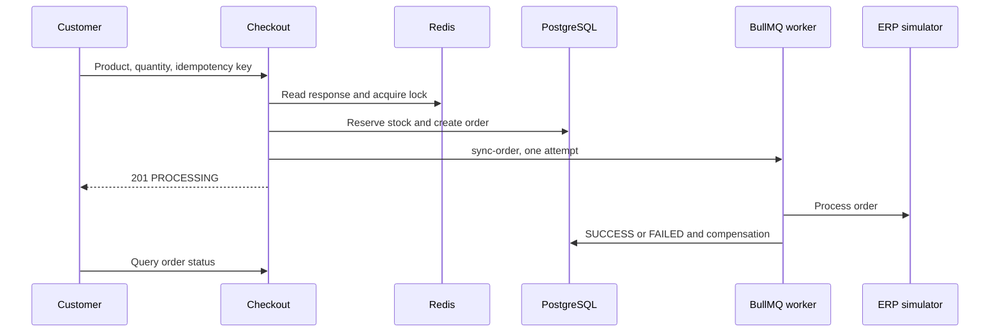

# casecell-checkout-service: Project context and workflows

GitPageDocs **0.0.17** · 1.0.0 · 2026-10-29

## Context

Product checkout with stock reservation, orders, idempotency and asynchronous synchronization with a simulated ERP. It includes catalog, authentication, order history/status and administration. The initial response confirms acceptance for processing; the ERP outcome is queried later.

## Stack and architecture

NestJS 10.3, Prisma 5.11/PostgreSQL, Redis, BullMQ 4, JWT/Passport and Argon2. Domain holds entities/contracts; application commands/queries/ports; infrastructure Prisma/Redis/queue/ERP adapters; presentation controllers. Frontend declares Next.js ^15.0.0-canary.120, React ^18.3.1, Redux Persist and TanStack Query 5. Check the lockfile for resolved versions; the manifest uses a prerelease range.

## End-to-end workflows

1. Authentication → catalog → one productId and quantity → POST /api/v1/checkout with Bearer JWT and Idempotency-Key. Only CUSTOMER can checkout; customerId comes from the token. Missing key returns 400. DTO/use case validate quantity/product; price comes from the database.

2. Redis idempotency lookup returns duplicate=true/HTTP 200 when cached. Otherwise it acquires lock:product:{id} for 5000 ms. A Prisma transaction verifies an active product, conditionally decrements stock where stock >= quantity and creates a PENDING order/items. Insufficient stock returns 409; missing/inactive products fail. It then marks PROCESSING, queues sync-order and caches the response with configurable TTL (default 600 s). Initial success is HTTP 201.

3. The worker reads the order and erp:global circuit breaker. Gateway success marks SUCCESS, updates idempotency, invalidates catalog and records metrics. Failure/open circuit marks FAILED and attempts stock release; gateway errors are rethrown. EnqueueErpSyncCommand uses attempts:1 and no backoff: this job has no automatic business retry. Failed jobs are retained for inspection.

4. The UI follows order status/history; administration changes products and queries orders according to roles. Technical failures after reservation attempt stock compensation and FAILED status. Compensation has its own logs and can fail; inspect database/queue before manually retrying an order.

## Data, security and limitations

Core model: User, Product, Order and OrderItem; prices/totals use cents. Token revocation, password hashing and role guards are implemented. This command's idempotency cache uses the supplied key without payload comparison: generate a new key per purchase intent and reuse it only for the same intent. Enqueue happens after SQL commit without a transactional outbox; failures between stages require inspection. TTL locks/unique keys do not guarantee end-to-end exactly-once execution.

## Setup, testing and operations

Copy envexample.txt to .env. Compose contains PostgreSQL, Redis, backend/frontend and test services. Prisma scripts use run-with-env; distinguish prisma:migrate (development) from prisma:deploy (existing migrations). Backend npm test runs database-preparing pretest: use a dedicated test database. Run unit/integration/e2e, lint/build per package.json. Persistent PROCESSING: worker/queue; FAILED: ERP/compensation logs; 409: stock/lock; 401/403: token/role. HTTP metrics/Pino help correlation; the current ERP is simulated.

## Complete reference

Dependencies, commands, endpoints, variables, contracts and tests are in the [source reference](?menu=en&lang=en&id=9).

## Verifiable sources

- [backend/src/main.ts](https://github.com/Vidigal-code/casecell-checkout-service/blob/0710aade2a2137cc98f52f138f8c883e7fdd4a4b/backend/src/main.ts)

- [backend/src/presentation/http/checkout/checkout.controller.ts](https://github.com/Vidigal-code/casecell-checkout-service/blob/0710aade2a2137cc98f52f138f8c883e7fdd4a4b/backend/src/presentation/http/checkout/checkout.controller.ts)

- [backend/src/application/checkout/create-checkout.command.ts](https://github.com/Vidigal-code/casecell-checkout-service/blob/0710aade2a2137cc98f52f138f8c883e7fdd4a4b/backend/src/application/checkout/create-checkout.command.ts)

- [backend/src/application/checkout/enqueue-erp-sync.command.ts](https://github.com/Vidigal-code/casecell-checkout-service/blob/0710aade2a2137cc98f52f138f8c883e7fdd4a4b/backend/src/application/checkout/enqueue-erp-sync.command.ts)

- [backend/src/infrastructure/queues/erp-sync.processor.ts](https://github.com/Vidigal-code/casecell-checkout-service/blob/0710aade2a2137cc98f52f138f8c883e7fdd4a4b/backend/src/infrastructure/queues/erp-sync.processor.ts)

- [backend/prisma/schema.prisma](https://github.com/Vidigal-code/casecell-checkout-service/blob/0710aade2a2137cc98f52f138f8c883e7fdd4a4b/backend/prisma/schema.prisma)

- [docker-compose.yml](https://github.com/Vidigal-code/casecell-checkout-service/blob/0710aade2a2137cc98f52f138f8c883e7fdd4a4b/docker-compose.yml)
