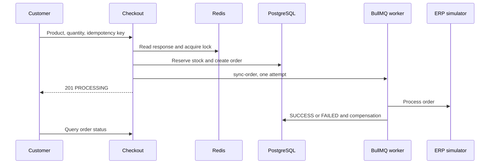

# Arquitectura y diseño

Checkout de producto con reserva de inventario, pedido, idempotencia y sincronización asíncrona con ERP simulado. Incluye catálogo, autenticación, historial/estado y administración. La respuesta inicial confirma aceptación para procesamiento; el resultado ERP se consulta después.

## Comportamiento implementado

NestJS 10.3, Prisma 5.11/PostgreSQL, Redis, BullMQ 4, JWT/Passport y Argon2. Domain contiene entidades/contratos; application comandos/queries/puertos; infrastructure adaptadores Prisma/Redis/colas/ERP; presentation controllers. Frontend declara Next.js ^15.0.0-canary.120, React ^18.3.1, Redux Persist y TanStack Query 5. Consulte lockfile; el manifest usa rango prerelease.

## Archivos relacionados

- [backend/src/main.ts](https://github.com/Vidigal-code/casecell-checkout-service/blob/0710aade2a2137cc98f52f138f8c883e7fdd4a4b/backend/src/main.ts)
- [backend/src/presentation/http/checkout/checkout.controller.ts](https://github.com/Vidigal-code/casecell-checkout-service/blob/0710aade2a2137cc98f52f138f8c883e7fdd4a4b/backend/src/presentation/http/checkout/checkout.controller.ts)
- [backend/src/application/checkout/create-checkout.command.ts](https://github.com/Vidigal-code/casecell-checkout-service/blob/0710aade2a2137cc98f52f138f8c883e7fdd4a4b/backend/src/application/checkout/create-checkout.command.ts)
- [backend/src/application/checkout/enqueue-erp-sync.command.ts](https://github.com/Vidigal-code/casecell-checkout-service/blob/0710aade2a2137cc98f52f138f8c883e7fdd4a4b/backend/src/application/checkout/enqueue-erp-sync.command.ts)
- [backend/src/infrastructure/queues/erp-sync.processor.ts](https://github.com/Vidigal-code/casecell-checkout-service/blob/0710aade2a2137cc98f52f138f8c883e7fdd4a4b/backend/src/infrastructure/queues/erp-sync.processor.ts)
- [backend/prisma/schema.prisma](https://github.com/Vidigal-code/casecell-checkout-service/blob/0710aade2a2137cc98f52f138f8c883e7fdd4a4b/backend/prisma/schema.prisma)
- [docker-compose.yml](https://github.com/Vidigal-code/casecell-checkout-service/blob/0710aade2a2137cc98f52f138f8c883e7fdd4a4b/docker-compose.yml)

## Navegación

- [Project guide](?menu=es&lang=es&id=8)
- [Source reference](?menu=es&lang=es&id=9)
