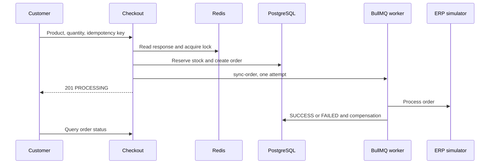

# casecell-checkout-service: Contexto y flujos del proyecto

GitPageDocs **0.0.24** · 1.0.0 · 2026-11-08

## Contexto

Checkout de producto con reserva de inventario, pedido, idempotencia y sincronización asíncrona con ERP simulado. Incluye catálogo, autenticación, historial/estado y administración. La respuesta inicial confirma aceptación para procesamiento; el resultado ERP se consulta después.

## Stack y arquitectura

NestJS 10.3, Prisma 5.11/PostgreSQL, Redis, BullMQ 4, JWT/Passport y Argon2. Domain contiene entidades/contratos; application comandos/queries/puertos; infrastructure adaptadores Prisma/Redis/colas/ERP; presentation controllers. Frontend declara Next.js ^15.0.0-canary.120, React ^18.3.1, Redux Persist y TanStack Query 5. Consulte lockfile; el manifest usa rango prerelease.



## Flujos completos

1. Autenticación → catálogo → un productId y quantity → POST /api/v1/checkout con Bearer JWT e Idempotency-Key. Solo CUSTOMER puede comprar; customerId viene del token. Clave ausente: 400. DTO/caso de uso validan cantidad/producto; precio viene del banco.

2. Idempotencia Redis devuelve duplicate=true/HTTP 200 si hay respuesta. Si no, adquiere lock:product:{id} durante 5000 ms. Transacción Prisma verifica producto activo, decrementa con stock >= quantity y crea pedido PENDING/items. Inventario insuficiente: 409; producto ausente/inactivo falla. Luego marca PROCESSING, encola sync-order y cachea respuesta con TTL configurable (600 s). Éxito inicial: HTTP 201.

3. Worker consulta pedido y circuit breaker erp:global. Éxito marca SUCCESS, actualiza idempotencia, invalida catálogo y registra métricas. Error/circuito abierto marca FAILED e intenta devolver inventario; errores del gateway se propagan. EnqueueErpSyncCommand usa attempts:1 sin backoff: no hay retry automático de negocio. Jobs fallidos se conservan.

4. La interfaz sigue estado/historial; administración modifica productos y consulta pedidos según roles. Fallos técnicos tras reservar intentan compensar inventario y marcar FAILED. Compensación tiene logs y puede fallar; inspeccione banco/cola antes de repetir manualmente.

## Datos, seguridad y límites

Modelo: User, Product, Order y OrderItem; precios/totales en centavos. Hay revocación de tokens, hash y guards. Idempotencia usa la clave recibida sin comparar payload en este comando: use clave nueva por intención y repítala solo para esa intención. Enqueue ocurre tras commit SQL sin outbox transaccional; fallos entre etapas requieren inspección. Locks TTL/claves únicas no garantizan exactly-once completo.

## Ejecución, pruebas y operación

Copie envexample.txt a .env. Compose contiene PostgreSQL, Redis, aplicaciones y servicios de prueba. Scripts Prisma usan run-with-env; diferencie prisma:migrate de desarrollo y prisma:deploy de migrations existentes. npm test backend ejecuta pretest que prepara banco: use uno dedicado. Ejecute unit/integration/e2e, lint/build. PROCESSING persistente: worker/cola; FAILED: ERP/compensación; 409: inventario/lock; 401/403: token/rol. Métricas/Pino ayudan; ERP es simulado.

## Referencia completa

Dependencias, comandos, endpoints, variables, contratos y pruebas están en la [referencia del código](?menu=es&lang=es&id=9).

## Fuentes verificables

- [backend/src/main.ts](https://github.com/Vidigal-code/casecell-checkout-service/blob/0710aade2a2137cc98f52f138f8c883e7fdd4a4b/backend/src/main.ts)

- [backend/src/presentation/http/checkout/checkout.controller.ts](https://github.com/Vidigal-code/casecell-checkout-service/blob/0710aade2a2137cc98f52f138f8c883e7fdd4a4b/backend/src/presentation/http/checkout/checkout.controller.ts)

- [backend/src/application/checkout/create-checkout.command.ts](https://github.com/Vidigal-code/casecell-checkout-service/blob/0710aade2a2137cc98f52f138f8c883e7fdd4a4b/backend/src/application/checkout/create-checkout.command.ts)

- [backend/src/application/checkout/enqueue-erp-sync.command.ts](https://github.com/Vidigal-code/casecell-checkout-service/blob/0710aade2a2137cc98f52f138f8c883e7fdd4a4b/backend/src/application/checkout/enqueue-erp-sync.command.ts)

- [backend/src/infrastructure/queues/erp-sync.processor.ts](https://github.com/Vidigal-code/casecell-checkout-service/blob/0710aade2a2137cc98f52f138f8c883e7fdd4a4b/backend/src/infrastructure/queues/erp-sync.processor.ts)

- [backend/prisma/schema.prisma](https://github.com/Vidigal-code/casecell-checkout-service/blob/0710aade2a2137cc98f52f138f8c883e7fdd4a4b/backend/prisma/schema.prisma)

- [docker-compose.yml](https://github.com/Vidigal-code/casecell-checkout-service/blob/0710aade2a2137cc98f52f138f8c883e7fdd4a4b/docker-compose.yml)

## Navegación de la documentación con GitPageDocs 0.0.24

Las opciones de esta sección requieren el runtime GitPageDocs **0.0.24**. La versión documental de este proyecto sigue siendo **1.0.0**. Actualizar texto y configuración no actualiza por sí solo el runtime publicado por el workflow.

### Índice por etiquetas

En `gitpagedocs/docs/versions/1.0.0/config.json`, cada elemento de `routes-md` utiliza `RouteguideBrand: true` y `RouteGuideTags: ["h1", "h2", "h3"]`. El índice incluye los tres primeros niveles de encabezados; los demás permanecen en el documento. Los nombres de propiedades distinguen mayúsculas y minúsculas.

```json
{ "RouteguideBrand": true, "RouteGuideTags": ["h1", "h2", "h3"] }
```

Omitir `RouteGuideTags` conserva el comportamiento anterior, de `h1` a `h6`. Una lista vacía (`[]`) elimina las entradas automáticas por etiqueta; los marcadores explícitos configurados en `markdownMarkers.items` todavía pueden formar parte del índice.

Para incluir otros elementos, añada nombres de etiquetas permitidas por el sanitizador, como `"p"`, `"blockquote"`, `"pre"`, `"table"`, `"img"`, `"details"` o `"summary"`. No hay comodines: `"*"`, las etiquetas peligrosas y las entradas inválidas se ignoran con un diagnóstico. Incluir `p`, `li`, `div` o `span` puede generar muchas entradas; seleccione solo las etiquetas útiles para la lectura.

Los rótulos usan título, texto alternativo o texto del elemento. Los elementos vacíos como `br`, `hr`, `img` e `input` pueden usar el nombre de la etiqueta. Los IDs automáticos son estables, únicos y separados por bloque. Utilice `markdownMarkers.items` para elegir una ocurrencia, definir un rótulo propio o aplicar un resaltado específico.

### Desplazamiento, pantallas pequeñas y plegables

Con el desplazamiento del índice desbloqueado, la entrada activa queda centrada, incluso al navegar con Anterior/Siguiente. El candado conserva la posición elegida manualmente en el índice. Esto permite consultar otra parte del índice sin que el seguimiento automático desplace la lista.

Al validar en un móvil, revise el menú contraído, las áreas táctiles, el foco del teclado, las tablas y los bloques de código con desplazamiento horizontal. En dispositivos plegables, repita la navegación con la pantalla plegada y abierta, en ambas orientaciones, y compruebe que la entrada activa siga accesible tras cambiar el ancho. Utilice el control de pausa cuando haya efectos animados y respete la preferencia de movimiento reducido.

GitPageDocs 0.0.24 utiliza `performance.mode: "auto"` para los efectos de los temas: reduce moderadamente la densidad en escritorio y utiliza un presupuesto menor por debajo de 768px, conservando las capas del tema. Las partículas ocultas se pausan y retoman la misma fase al cambiar el ancho. Para mantener la densidad completa, combine `site.backgroundEffects.overrides.performance: { "mode": "full" }` con `gitpagedocs/config.json`; la misma opción está disponible en `site.backgroundEffects.themes[themeId].performance`. Un override explícito de `layers` conserva la cantidad completa cuando no se define mode en los overrides. Seleccione `"auto"` explícitamente para aplicar el presupuesto también a las capas personalizadas.

## Familia de tema fija y modo claro/oscuro

`HideThemeSelector: true` oculta el selector completo de temas y mantiene la familia elegida por `ThemeDefault`. La alternancia claro/oscuro sigue disponible cuando esa familia tiene un par válido. Un tema diferente procedente de la URL o del almacenamiento del navegador no sustituye la familia fija.

`ThemeModeDefault` es el valor inicial de respaldo. Un modo válido en `modetheme=light` o `modetheme=dark` de la URL, un modo guardado o el botón del lector puede seleccionar claro/oscuro dentro de esa familia. El modo elegido se conserva al recargar y navegar entre documentos. En pantallas estrechas, abra Menu para acceder al control estándar. Sin un par válido, el control no aparece.

Las dos entradas del catálogo de layouts deben habilitar `supportsLightAndDarkModes`, compartir el mismo `supportsLightAndDarkModesReference` no vacío y declarar valores opuestos de `mode` (`light` y `dark`). Este proyecto utiliza el catálogo oficial con pares; conserve su familia y preferencias al actualizar los pins del runtime o de los layouts.
