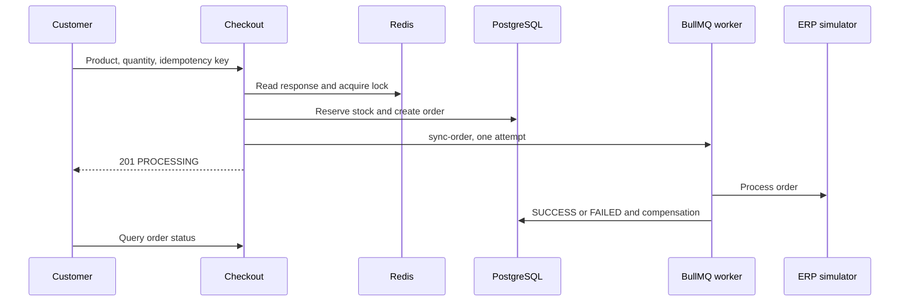

# Visión general del case

Checkout de producto con reserva de inventario, pedido, idempotencia y sincronización asíncrona con ERP simulado. Incluye catálogo, autenticación, historial/estado y administración. La respuesta inicial confirma aceptación para procesamiento; el resultado ERP se consulta después.

## Comportamiento implementado

NestJS 10.3, Prisma 5.11/PostgreSQL, Redis, BullMQ 4, JWT/Passport y Argon2. Domain contiene entidades/contratos; application comandos/queries/puertos; infrastructure adaptadores Prisma/Redis/colas/ERP; presentation controllers. Frontend declara Next.js ^15.0.0-canary.120, React ^18.3.1, Redux Persist y TanStack Query 5. Consulte lockfile; el manifest usa rango prerelease.



## Flujo y casos de fallo

1. Autenticación → catálogo → un productId y quantity → POST /api/v1/checkout con Bearer JWT e Idempotency-Key. Solo CUSTOMER puede comprar; customerId viene del token. Clave ausente: 400. DTO/caso de uso validan cantidad/producto; precio viene del banco.

2. Idempotencia Redis devuelve duplicate=true/HTTP 200 si hay respuesta. Si no, adquiere lock:product:{id} durante 5000 ms. Transacción Prisma verifica producto activo, decrementa con stock >= quantity y crea pedido PENDING/items. Inventario insuficiente: 409; producto ausente/inactivo falla. Luego marca PROCESSING, encola sync-order y cachea respuesta con TTL configurable (600 s). Éxito inicial: HTTP 201.

3. Worker consulta pedido y circuit breaker erp:global. Éxito marca SUCCESS, actualiza idempotencia, invalida catálogo y registra métricas. Error/circuito abierto marca FAILED e intenta devolver inventario; errores del gateway se propagan. EnqueueErpSyncCommand usa attempts:1 sin backoff: no hay retry automático de negocio. Jobs fallidos se conservan.

4. La interfaz sigue estado/historial; administración modifica productos y consulta pedidos según roles. Fallos técnicos tras reservar intentan compensar inventario y marcar FAILED. Compensación tiene logs y puede fallar; inspeccione banco/cola antes de repetir manualmente.

## Configuración y despliegue

Copie envexample.txt a .env. Compose contiene PostgreSQL, Redis, aplicaciones y servicios de prueba. Scripts Prisma usan run-with-env; diferencie prisma:migrate de desarrollo y prisma:deploy de migrations existentes. npm test backend ejecuta pretest que prepara banco: use uno dedicado. Ejecute unit/integration/e2e, lint/build. PROCESSING persistente: worker/cola; FAILED: ERP/compensación; 409: inventario/lock; 401/403: token/rol. Métricas/Pino ayudan; ERP es simulado.

## Comandos de ejecución

```sh
docker compose up --build
# Validation in a separately configured test environment
npm --prefix backend install
npm --prefix backend run test:unit
npm --prefix backend run test:integration
npm --prefix backend run build
npm --prefix frontend install
npm --prefix frontend run build
```

## Archivos relacionados

- [backend/src/main.ts](https://github.com/Vidigal-code/casecell-checkout-service/blob/0710aade2a2137cc98f52f138f8c883e7fdd4a4b/backend/src/main.ts)
- [backend/src/presentation/http/checkout/checkout.controller.ts](https://github.com/Vidigal-code/casecell-checkout-service/blob/0710aade2a2137cc98f52f138f8c883e7fdd4a4b/backend/src/presentation/http/checkout/checkout.controller.ts)
- [backend/src/application/checkout/create-checkout.command.ts](https://github.com/Vidigal-code/casecell-checkout-service/blob/0710aade2a2137cc98f52f138f8c883e7fdd4a4b/backend/src/application/checkout/create-checkout.command.ts)
- [backend/src/application/checkout/enqueue-erp-sync.command.ts](https://github.com/Vidigal-code/casecell-checkout-service/blob/0710aade2a2137cc98f52f138f8c883e7fdd4a4b/backend/src/application/checkout/enqueue-erp-sync.command.ts)
- [backend/src/infrastructure/queues/erp-sync.processor.ts](https://github.com/Vidigal-code/casecell-checkout-service/blob/0710aade2a2137cc98f52f138f8c883e7fdd4a4b/backend/src/infrastructure/queues/erp-sync.processor.ts)
- [backend/prisma/schema.prisma](https://github.com/Vidigal-code/casecell-checkout-service/blob/0710aade2a2137cc98f52f138f8c883e7fdd4a4b/backend/prisma/schema.prisma)
- [docker-compose.yml](https://github.com/Vidigal-code/casecell-checkout-service/blob/0710aade2a2137cc98f52f138f8c883e7fdd4a4b/docker-compose.yml)

## Navegación

- [Project guide](?menu=es&lang=es&id=8)
- [Source reference](?menu=es&lang=es&id=9)
