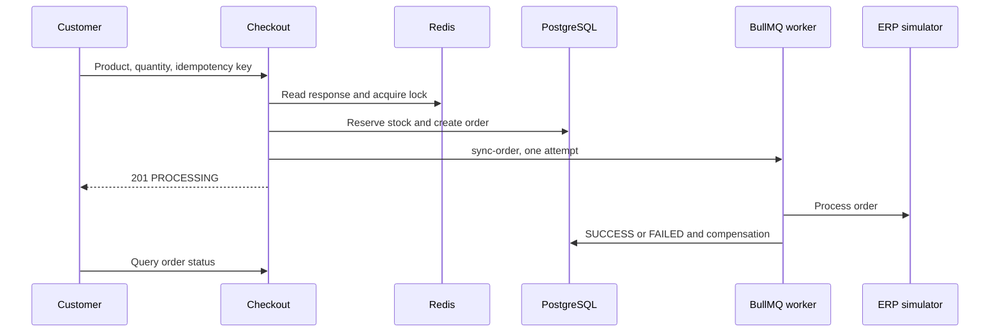

# casecell-checkout-service: Contexto e fluxos do projeto

GitPageDocs **0.0.24** · 1.0.0 · 2026-11-08

## Contexto

Checkout de produto com reserva de estoque, pedido, idempotência e sincronização assíncrona com ERP simulado. Há catálogo, autenticação, histórico/status de pedidos e administração. A resposta inicial confirma que o pedido foi aceito para processamento; o resultado do ERP é consultado posteriormente.

## Stack e arquitetura

NestJS 10.3, Prisma 5.11/PostgreSQL, Redis, BullMQ 4, JWT/Passport e Argon2. Domain contém entidades/contratos; application comandos/queries/portas; infrastructure adaptadores Prisma/Redis/filas/ERP; presentation controllers. Frontend declara Next.js ^15.0.0-canary.120 e React ^18.3.1, Redux Persist e TanStack Query 5. Consulte o lockfile para a versão resolvida; o manifest usa uma faixa de pré-release.



## Fluxos completos

1. Autenticação → catálogo → seleção de um productId e quantity → POST /api/v1/checkout com Bearer JWT e Idempotency-Key. Apenas CUSTOMER pode criar checkout; customerId vem do token. Chave ausente retorna 400. A quantidade e o produto passam pelo DTO e caso de uso; o preço vem do registro no banco.

2. Consulta resposta idempotente no Redis; se existente, devolve duplicate=true com HTTP 200. Caso contrário adquire lock:product:{id} por 5000 ms. Na transação Prisma verifica produto ativo, decrementa estoque condicionalmente com stock >= quantity e cria pedido PENDING/itens. Estoque insuficiente retorna 409; produto inexistente/inativo falha. Depois marca PROCESSING, adiciona sync-order na fila e armazena resposta por TTL configurável (padrão 600 s). Sucesso inicial é HTTP 201.

3. O worker consulta pedido e circuit breaker erp:global. Gateway aprovado marca SUCCESS, atualiza resposta idempotente, invalida catálogo e registra métricas. Erro ou circuito aberto marca FAILED e tenta devolver estoque; erro do gateway é relançado. EnqueueErpSyncCommand configura attempts:1 e sem backoff: não há retry automático de negócio nesse job. Jobs falhos são preservados para inspeção.

4. A interface acompanha status/histórico; administração altera produtos e consulta pedidos conforme roles. Erros técnicos após reservar estoque tentam compensar reserva e marcar pedido FAILED. Essas compensações têm logs próprios e podem falhar; verifique banco e fila antes de repetir manualmente um pedido.

## Dados, segurança e limites

Modelo central: User, Product, Order e OrderItem; preços/totais usam centavos. Há revogação de tokens, hash de senha e guards de roles. O cache de idempotência usa a chave recebida, sem comparação de payload nesse comando: gere uma chave nova por intenção de compra e reutilize-a apenas para repetir a mesma intenção. O enqueue ocorre após commit SQL, sem outbox transacional; uma falha entre as etapas exige inspeção. Lock com TTL e chave única não equivalem a garantia de exactly-once fim a fim.

## Execução, testes e operação

Copie envexample.txt para .env. Compose contém PostgreSQL, Redis, backend, frontend e serviços de teste. Scripts Prisma usam run-with-env; separe prisma:migrate (desenvolvimento) de prisma:deploy (migrations existentes). npm test do backend executa pretest que prepara banco: use banco de teste dedicado. Rode suítes unit/integration/e2e, lint e build conforme package.json. Para PROCESSING persistente, confira worker/fila; FAILED, logs ERP/compensação; 409, estoque/lock; 401/403, token/role. Métricas HTTP e Pino auxiliam a correlação; o ERP atual é simulado.

## Referência completa

Dependências, comandos, endpoints, variáveis, contratos e testes estão na [referência do código](?menu=pt&lang=pt&id=9).

## Fontes verificáveis

- [backend/src/main.ts](https://github.com/Vidigal-code/casecell-checkout-service/blob/0710aade2a2137cc98f52f138f8c883e7fdd4a4b/backend/src/main.ts)

- [backend/src/presentation/http/checkout/checkout.controller.ts](https://github.com/Vidigal-code/casecell-checkout-service/blob/0710aade2a2137cc98f52f138f8c883e7fdd4a4b/backend/src/presentation/http/checkout/checkout.controller.ts)

- [backend/src/application/checkout/create-checkout.command.ts](https://github.com/Vidigal-code/casecell-checkout-service/blob/0710aade2a2137cc98f52f138f8c883e7fdd4a4b/backend/src/application/checkout/create-checkout.command.ts)

- [backend/src/application/checkout/enqueue-erp-sync.command.ts](https://github.com/Vidigal-code/casecell-checkout-service/blob/0710aade2a2137cc98f52f138f8c883e7fdd4a4b/backend/src/application/checkout/enqueue-erp-sync.command.ts)

- [backend/src/infrastructure/queues/erp-sync.processor.ts](https://github.com/Vidigal-code/casecell-checkout-service/blob/0710aade2a2137cc98f52f138f8c883e7fdd4a4b/backend/src/infrastructure/queues/erp-sync.processor.ts)

- [backend/prisma/schema.prisma](https://github.com/Vidigal-code/casecell-checkout-service/blob/0710aade2a2137cc98f52f138f8c883e7fdd4a4b/backend/prisma/schema.prisma)

- [docker-compose.yml](https://github.com/Vidigal-code/casecell-checkout-service/blob/0710aade2a2137cc98f52f138f8c883e7fdd4a4b/docker-compose.yml)

## Navegação da documentação com GitPageDocs 0.0.24

As opções desta seção requerem o runtime GitPageDocs **0.0.24**. A versão documental deste projeto continua **1.0.0**. Atualizar o texto e a configuração não atualiza, por si só, o runtime publicado pelo workflow.

### Índice por tags

Em `gitpagedocs/docs/versions/1.0.0/config.json`, cada item de `routes-md` usa `RouteguideBrand: true` e `RouteGuideTags: ["h1", "h2", "h3"]`. O índice mantém os três primeiros níveis de títulos; os demais títulos continuam no documento. A grafia das propriedades diferencia maiúsculas e minúsculas.

```json
{ "RouteguideBrand": true, "RouteGuideTags": ["h1", "h2", "h3"] }
```

Omitir `RouteGuideTags` preserva o comportamento legado, com `h1` até `h6`. Uma lista vazia (`[]`) remove as entradas automáticas por tag; marcadores explícitos configurados em `markdownMarkers.items` ainda podem compor o índice.

Para incluir outros elementos, acrescente nomes de tags permitidas pelo sanitizador, por exemplo `"p"`, `"blockquote"`, `"pre"`, `"table"`, `"img"`, `"details"` ou `"summary"`. Não existe curinga: `"*"`, tags perigosas e entradas inválidas são ignorados com diagnóstico. Incluir `p`, `li`, `div` ou `span` pode gerar muitas entradas; prefira somente as tags úteis para a leitura.

Os rótulos usam título, texto alternativo ou texto do elemento. Elementos vazios como `br`, `hr`, `img` e `input` podem usar o nome da tag. IDs automáticos são estáveis, únicos e separados por bloco. Use `markdownMarkers.items` quando precisar escolher uma ocorrência, definir rótulo próprio ou aplicar um destaque específico.

### Rolagem, telas pequenas e dobráveis

Com a rolagem do índice desbloqueada, o item ativo é centralizado, inclusive ao navegar por Anterior/Próximo. O cadeado preserva a posição escolhida manualmente no índice. Isso permite consultar outra parte do índice sem que o acompanhamento automático reposicione a lista.

Ao validar em celular, confira o menu recolhido, alvos de toque, foco por teclado, tabelas e blocos de código com rolagem horizontal. Em dispositivos dobráveis, repita a navegação com a tela dobrada e aberta, nas duas orientações, e confirme que o item ativo permanece acessível após a mudança de largura. Use o controle de pausa quando houver efeitos animados e respeite a preferência de movimento reduzido.

O GitPageDocs 0.0.24 usa `performance.mode: "auto"` nos efeitos dos temas: reduz moderadamente a densidade no desktop e usa um orçamento menor abaixo de 768px, mantendo as camadas do tema. Partículas ocultas ficam pausadas e retomam a mesma fase ao mudar a largura. Para manter a densidade completa, mescle `site.backgroundEffects.overrides.performance: { "mode": "full" }` em `gitpagedocs/config.json`; a mesma opção pode ser definida em `site.backgroundEffects.themes[themeId].performance`. Um override explícito de `layers` mantém a contagem completa quando não há mode definido nos overrides. Use `"auto"` explicitamente para aplicar o orçamento também às camadas personalizadas.

## Família de tema fixa e modo claro/escuro

`HideThemeSelector: true` oculta o seletor completo de temas e mantém a família escolhida por `ThemeDefault`. A alternância claro/escuro continua disponível quando essa família possui um par válido. Um tema diferente vindo da URL ou do armazenamento do navegador não substitui a família fixa.

`ThemeModeDefault` é o fallback inicial. Um modo válido em `modetheme=light` ou `modetheme=dark` na URL, um modo salvo ou o botão do leitor pode selecionar claro/escuro dentro dessa família. O modo escolhido permanece após recarregar e navegar entre documentos. Em telas estreitas, abra Menu para acessar o controle padrão. Sem um par válido, o controle não aparece.

As duas entradas do catálogo de layouts devem habilitar `supportsLightAndDarkModes`, compartilhar o mesmo `supportsLightAndDarkModesReference` não vazio e declarar valores opostos de `mode` (`light` e `dark`). Este projeto usa o catálogo oficial com pares; preserve sua família e preferências ao atualizar os pins do runtime ou dos layouts.
