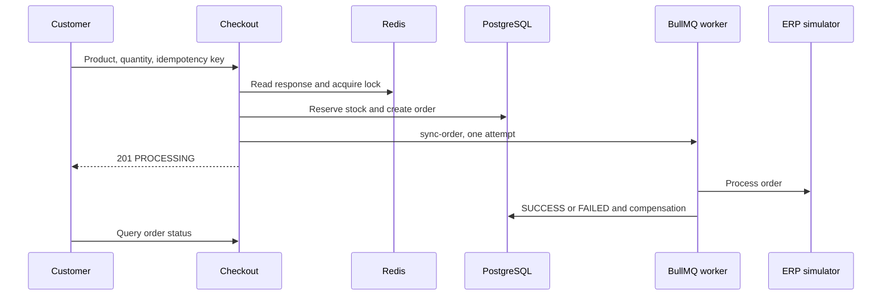

# Visão geral do case

Checkout de produto com reserva de estoque, pedido, idempotência e sincronização assíncrona com ERP simulado. Há catálogo, autenticação, histórico/status de pedidos e administração. A resposta inicial confirma que o pedido foi aceito para processamento; o resultado do ERP é consultado posteriormente.

## Comportamento implementado

NestJS 10.3, Prisma 5.11/PostgreSQL, Redis, BullMQ 4, JWT/Passport e Argon2. Domain contém entidades/contratos; application comandos/queries/portas; infrastructure adaptadores Prisma/Redis/filas/ERP; presentation controllers. Frontend declara Next.js ^15.0.0-canary.120 e React ^18.3.1, Redux Persist e TanStack Query 5. Consulte o lockfile para a versão resolvida; o manifest usa uma faixa de pré-release.



## Fluxo e casos de falha

1. Autenticação → catálogo → seleção de um productId e quantity → POST /api/v1/checkout com Bearer JWT e Idempotency-Key. Apenas CUSTOMER pode criar checkout; customerId vem do token. Chave ausente retorna 400. A quantidade e o produto passam pelo DTO e caso de uso; o preço vem do registro no banco.

2. Consulta resposta idempotente no Redis; se existente, devolve duplicate=true com HTTP 200. Caso contrário adquire lock:product:{id} por 5000 ms. Na transação Prisma verifica produto ativo, decrementa estoque condicionalmente com stock >= quantity e cria pedido PENDING/itens. Estoque insuficiente retorna 409; produto inexistente/inativo falha. Depois marca PROCESSING, adiciona sync-order na fila e armazena resposta por TTL configurável (padrão 600 s). Sucesso inicial é HTTP 201.

3. O worker consulta pedido e circuit breaker erp:global. Gateway aprovado marca SUCCESS, atualiza resposta idempotente, invalida catálogo e registra métricas. Erro ou circuito aberto marca FAILED e tenta devolver estoque; erro do gateway é relançado. EnqueueErpSyncCommand configura attempts:1 e sem backoff: não há retry automático de negócio nesse job. Jobs falhos são preservados para inspeção.

4. A interface acompanha status/histórico; administração altera produtos e consulta pedidos conforme roles. Erros técnicos após reservar estoque tentam compensar reserva e marcar pedido FAILED. Essas compensações têm logs próprios e podem falhar; verifique banco e fila antes de repetir manualmente um pedido.

## Configuração e implantação

Copie envexample.txt para .env. Compose contém PostgreSQL, Redis, backend, frontend e serviços de teste. Scripts Prisma usam run-with-env; separe prisma:migrate (desenvolvimento) de prisma:deploy (migrations existentes). npm test do backend executa pretest que prepara banco: use banco de teste dedicado. Rode suítes unit/integration/e2e, lint e build conforme package.json. Para PROCESSING persistente, confira worker/fila; FAILED, logs ERP/compensação; 409, estoque/lock; 401/403, token/role. Métricas HTTP e Pino auxiliam a correlação; o ERP atual é simulado.

## Comandos de execução

```sh
docker compose up --build
# Validation in a separately configured test environment
npm --prefix backend install
npm --prefix backend run test:unit
npm --prefix backend run test:integration
npm --prefix backend run build
npm --prefix frontend install
npm --prefix frontend run build
```

## Arquivos relacionados

- [backend/src/main.ts](https://github.com/Vidigal-code/casecell-checkout-service/blob/0710aade2a2137cc98f52f138f8c883e7fdd4a4b/backend/src/main.ts)
- [backend/src/presentation/http/checkout/checkout.controller.ts](https://github.com/Vidigal-code/casecell-checkout-service/blob/0710aade2a2137cc98f52f138f8c883e7fdd4a4b/backend/src/presentation/http/checkout/checkout.controller.ts)
- [backend/src/application/checkout/create-checkout.command.ts](https://github.com/Vidigal-code/casecell-checkout-service/blob/0710aade2a2137cc98f52f138f8c883e7fdd4a4b/backend/src/application/checkout/create-checkout.command.ts)
- [backend/src/application/checkout/enqueue-erp-sync.command.ts](https://github.com/Vidigal-code/casecell-checkout-service/blob/0710aade2a2137cc98f52f138f8c883e7fdd4a4b/backend/src/application/checkout/enqueue-erp-sync.command.ts)
- [backend/src/infrastructure/queues/erp-sync.processor.ts](https://github.com/Vidigal-code/casecell-checkout-service/blob/0710aade2a2137cc98f52f138f8c883e7fdd4a4b/backend/src/infrastructure/queues/erp-sync.processor.ts)
- [backend/prisma/schema.prisma](https://github.com/Vidigal-code/casecell-checkout-service/blob/0710aade2a2137cc98f52f138f8c883e7fdd4a4b/backend/prisma/schema.prisma)
- [docker-compose.yml](https://github.com/Vidigal-code/casecell-checkout-service/blob/0710aade2a2137cc98f52f138f8c883e7fdd4a4b/docker-compose.yml)

## Navegação

- [Project guide](?menu=pt&lang=pt&id=8)
- [Source reference](?menu=pt&lang=pt&id=9)
